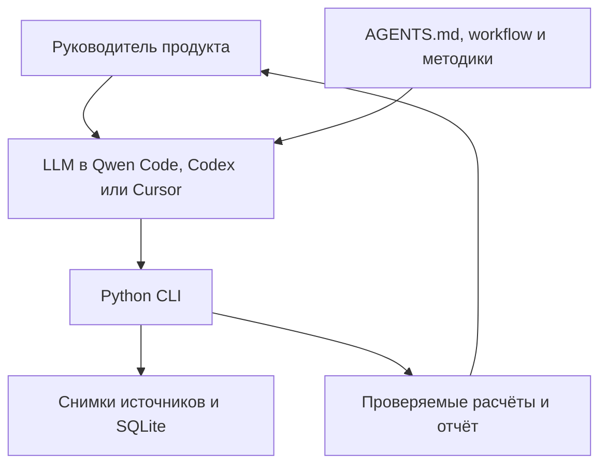

# Архитектура

Среда агента обеспечивает цикл вызовов LLM и инструментов. Репозиторий задаёт предметный процесс, методы, контракты результатов и программные проверки. Отдельного сервера и веб-интерфейса нет. Python CLI не вызывает модель, поэтому без подключённой среды он воспроизводит только сохранённые примеры и выполняет инструменты.

## Процесс и память

Этапы: бриф → исследование → варианты → стратегия → выбор человека → сопровождение. Варианты включают сохранение текущего продукта, изменение и закрытие. Перед переходом сохраняется артефакт; SQLite и ревизии защищают от частичной записи и устаревшего `--expect`. Одинаковый повторный `save` не создаёт новую ревизию.

Постоянные правила находятся в `AGENTS.md` и `agent/`, методики — в `knowledge/`, входные материалы — в `cases/<id>/materials/`, черновики — в `drafts/`, а снимки и состояние — в `state.sqlite3`. Старый ответ модели хранится как версия вывода, а не превращается в новый факт. Замена источника архивирует зависимые этапы и требует нового рассмотрения человеком.

## Компоненты и их польза

| Компонент | Назначение и граница |
|---|---|
| `sources.py` | Ограничения источников, статический HTTPS, снимки и хеши, адресация строк |
| `documents.py` | Локальное извлечение текста PDF и DOCX, снимок листа XLSX, связь строк со страницами и строками листа |
| `timing.py` | Проверка моментов со смещением, часовых поясов и календарных границ анализа и источников |
| `analysis.py` | Поиск по словам, взвешенные доли, точные значения ячеек и диапазоны; смысловой поиск не реализован |
| `checkpoints.py` | Структура, типы, ссылки и пересчёт объявленных чисел; семантическую истину не доказывает |
| `recovery.py` | Проверка черновиков и восстановление после сбоя без нового вызова LLM |
| `state.py` | Атомарные этапы, пауза, архив, зависимости и обязательства |
| `report.py` | Читаемый отчёт и основания отдельного вывода |
| `log` / `cost` | Ручной журнал обычных сеансов и отдельная сводка токенов для `qwen-run` |
| `budget.py` / `qwen.py` | Прогноз расхода этапа, проверка перед запросом и учёт фактического расхода Workers AI в базе кейса |

Маршрутизация реализована инструкциями выбора глубины и инструмента. Модель и провайдер задаются в среде; специализированного маршрутизатора моделей и MCP-сервера нет. Для сбора материалов есть профиль `materials-researcher` и переносимый контракт `agent/SUBAGENTS.md`. Среда запускает помощника в отдельном контексте; он возвращает сводку, а подробности хранит в файлах своей подзадачи. Главный агент проверяет результат и один сохраняет состояние кейса. Ограничение инструментов задаётся профилем среды, а границы записи терминалом — инструкциями, без отдельной OS-песочницы. Методика интервью есть, реальные интервью и синтетические беседы программно не проводятся. Аудио, видео и анализ интерфейсов отдельными инструментами не реализованы.

## Доверие

Источники рассматриваются как данные; команды из них не меняют доступы агента. Разрешение относится к конкретному URL. Синтетические материалы требуют области `demo`. Для чисел со ссылкой на таблицу нужны вычислимые проверки, однако агент и человек всё равно проверяют полноту аргумента, причинность и применимость. Ключи хранятся в конфигурации среды или переменных окружения вне репозитория. Рабочие кейсы исключены из Git.
